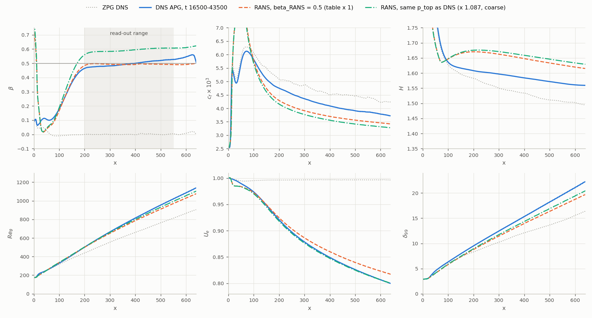
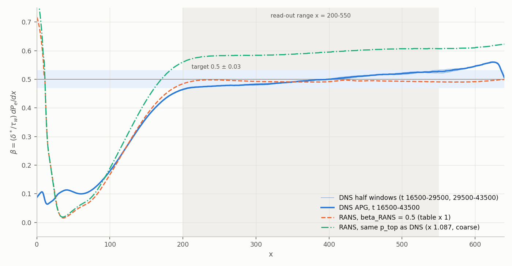
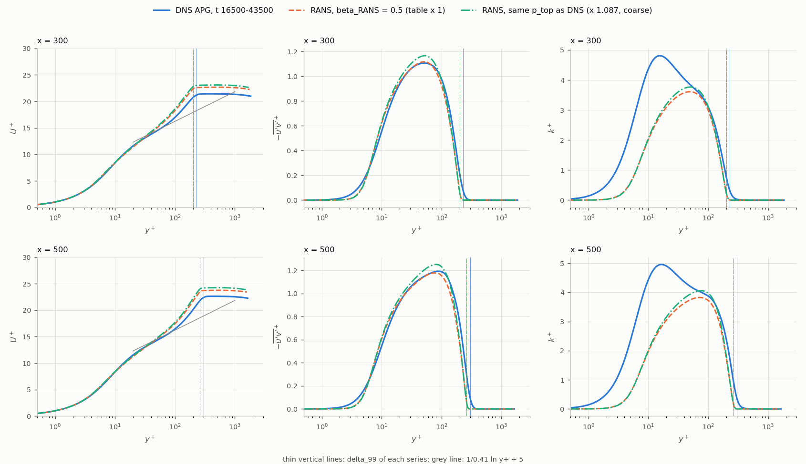
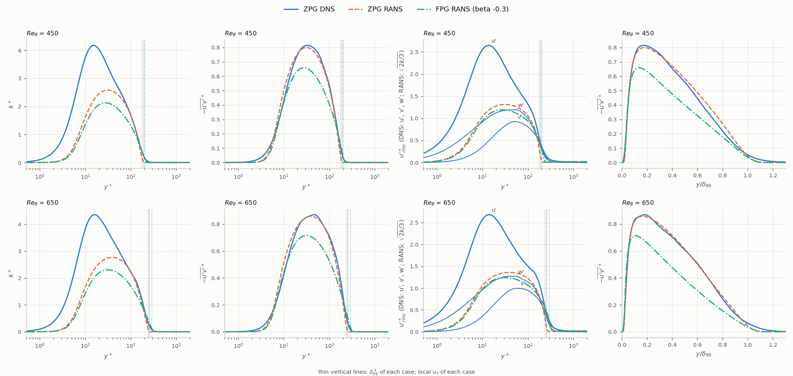

# Adverse-pressure-gradient boundary layer at constant Clauser parameter (DNS)

The DNS of the [`../apg.RANS`](../apg.RANS/README.md) layer: the ZPG DNS of
[`../smooth`](../smooth/README.md) with its top outlet under the pressure
table found in RANS, aiming at

    β = δ*/τ_w · dP_e/dx = +0.5

on x = 200–550 (Re_θ 500 → 1020). Units as in the DNS: lengths in δ*₀,
velocities in U∞, Re_δ*,0 = 450. The design and its reasoning are in
[`PLAN.md`](PLAN.md) (2026-11-16; its two "Update" sections are the run log).

**Result:** β over x = 200–550 has mean +0.497 (min +0.465, max +0.527) over
a 27 000 t.u. window. It is not flat: it rises from 0.465 at x = 200 to
0.527 at x = 550, where the RANS under the target table stays at
0.49. The layer stays attached: c_f falls only to 0.0037 at x ≈ 630.

## Set-up

What differs from the ZPG DNS:

- **The top outlet's pressure.** It is the RANS table
  [`ptop.txt`](ptop.txt) (= `../apg.RANS/ptop.txt`) times
  `y_max_p_value = 1.087` (`[boundary] y_max_p_profile = table`).
  - 1.087 = 1/r, where r = β_DNS/β_RANS = 0.92 is the ratio measured in the
    ZPG pair (`../apg.RANS/assets/beta_ratio_zpg.txt`).
  - Scaling the value scales the gradient exactly and keeps the datum
    p_top(650) = 0.
- **The span is doubled:** Lz = 52, nz = 272, the same Δz. The APG layer
  reaches δ99 ≈ 20 at x = 550, where Lz = 26 would be only 1.4 δ99
  (PLAN.md 1.2).
- **The trip** keeps the ZPG forcing spectrum on the wider box:
  - `trip_nmodes` goes 16 → 32: the same wavenumber band, twice the mode
    density.
  - `trip_amp` goes 0.18854 → 0.26664 (× √2): the same spectral density.
  - Everything else is unchanged (x0 10, lx 4, ly 1, ts 4).

Unchanged from the ZPG DNS:

- the grid in x and y (3200 × 384, the CaNS stretching 2.822);
- Re, the Blasius inlet and the outlet;
- CONS (divergence) convection, red-black SOR 6 / 1.5, dt capped at 0.02
  (Courant 0.41).

Under the APG, u_τ drops, so the grid is finer in wall units than in the ZPG
DNS: Δx⁺ ≤ 5.1, Δz⁺ ≤ 4.8, Δy⁺ at the wall ≤ 0.13 (PLAN.md 1.1).

**Start field.** The ZPG DNS field at t = 15 500 (step 775 000) tiled twice
in z ([`assets/tile_restart.py`](assets/tile_restart.py)):

- the second copy carries a 10⁻³ perturbation;
- the outlet planes are dropped, so the outlet face restarts from zero
  gradient;
- the file is the global-3D layout, which any rank count can read.

The tool was tested before use: on a small case, each tiled copy steps
forward identically to the untiled run.

**Run.** Legacy HoreKa, 8 A100 (2 nodes), account hk-project-exasim, code
`4b0dcc7`.

- [`horeka/submit_apgdns.sh`](horeka/submit_apgdns.sh) runs 12 500-step
  chunks (250 t.u., 46 min, 0.221 s/step) back to back inside a 24 h job.
  It self-chains to a deadline and restarts from the last chunk that ended
  cleanly. It restores the cumulative statistics file to that chunk's copy,
  writes `status.txt`, and keeps the two newest snapshots.
- Jobs 5242802 → 5242805 → 5246330 → 5248675, 16–20 Nov 2026: 112 chunks,
  t 15 500 → 43 500, no failure. About 700 GPU-h.

**Transient.** The switch to the APG raises the divergence residual
(L2_div) from the ZPG 6·10⁻⁶ to 2·10⁻⁴. It is back at 6–9·10⁻⁶ by t ≈ 16 400
and stays at 5.5·10⁻⁶. β settled within ≈ 1000 t.u. (two successive 500 t.u.
windows agreed), so **the statistics window is t = 16 500–43 500**.

## Results



[`assets/APG_DNS_stations.txt`](assets/APG_DNS_stations.txt) (window
t 16 500–43 500, [`assets/dns_pg.py`](assets/dns_pg.py)):

| x | Re_θ | H | c_f | U_e | δ99 | β | K·10⁶ |
|---|---|---|---|---|---|---|---|
| 100 | 329 | 1.636 | 0.00582 | 0.974 | 6.33 | +0.179 | −0.97 |
| 150 | 414 | 1.616 | 0.00509 | 0.949 | 7.94 | +0.365 | −1.39 |
| 200 | 502 | 1.608 | 0.00475 | 0.921 | 9.51 | +0.464 | −1.36 |
| 300 | 666 | 1.597 | 0.00436 | 0.879 | 12.46 | +0.482 | −0.98 |
| 400 | 815 | 1.584 | 0.00409 | 0.849 | 15.33 | +0.500 | −0.79 |
| 500 | 955 | 1.572 | 0.00391 | 0.826 | 18.24 | +0.520 | −0.68 |
| 550 | 1021 | 1.566 | 0.00386 | 0.816 | 19.66 | +0.527 | −0.64 |
| 600 | 1085 | 1.561 | 0.00379 | 0.807 | 21.04 | +0.545 | −0.61 |

- **Convergence.** The two halves of the window (t 16 500–29 500 and
  29 500–43 500) agree with the full window to within 0.006 in β, 0.7 % in
  c_f and 0.003 in H on x = 200–550 ([`assets/beta_halves.txt`](assets/beta_halves.txt)).



- **β is on target in the mean but tilted.** About two thirds of the tilt
  comes from the uniform × 1.087 scaling of a table tuned for a flat β at
  × 1: the RANS under the scaled table tilts the same way, 0.56 → 0.61. The
  rest is the drift of the δ* ratio along x already seen in the ZPG pair
  (next section).
- **Spanwise decorrelation of the tiled start.** On the last field,
  R_uu(Lz/2) averaged over 17 x-bands (x 200–560) is −0.13 … +0.04 for
  y/δ99 = 0.1–0.8, with a scatter of ±0.16–0.27 per band. The two copies are
  decorrelated, and Lz/δ99 is 2.6 at x = 550.

### Against the RANS

Same x, window as above. The RANS is `../apg.RANS/production_170182.h5`
(table × 1, β_RANS = 0.5). "Same p_top" is
[`rans_check/`](rans_check/check.ini), the coarse RANS (800 × 192) under the
DNS's table × 1.087, run to steady state (t 5100 → 7100):

| x | β DNS | β RANS | β RANS same p_top | c_f DNS | c_f RANS | H DNS | H RANS | Re_θ DNS | Re_θ RANS |
|---|---|---|---|---|---|---|---|---|---|
| 200 | +0.464 | +0.484 | +0.560 | 0.00475 | 0.00429 | 1.608 | 1.670 | 502 | 500 |
| 300 | +0.482 | +0.492 | +0.584 | 0.00436 | 0.00391 | 1.597 | 1.662 | 666 | 651 |
| 400 | +0.500 | +0.492 | +0.595 | 0.00409 | 0.00370 | 1.584 | 1.648 | 815 | 786 |
| 500 | +0.520 | +0.493 | +0.607 | 0.00391 | 0.00356 | 1.572 | 1.633 | 955 | 911 |
| 550 | +0.527 | +0.491 | +0.607 | 0.00386 | 0.00351 | 1.566 | 1.626 | 1021 | 970 |

At about the same β:

- the RANS c_f is 10–11 % below the DNS, against 3–6 % in the ZPG pair;
- the RANS H is 0.06 higher;
- the DNS layer grows faster: Re_θ +5 % and δ99 +8 % at x = 550.



In the profiles at x = 300 and 500:

- the RANS U⁺ wake is 1.3–1.5 higher, as its lower c_f implies;
- the −u′v′⁺ peak agrees within 2–5 %, but the RANS layer is thinner;
- the DNS near-wall k⁺ peak (≈ 5 at y⁺ ≈ 15) is missing in the eddy-viscosity
  model.

### The RANS → DNS transfer, measured

DNS against the same-p_top RANS, ratios DNS/RANS at the same x:

| x | r = β ratio | dP_e/dx | δ* | τ_w RANS/DNS | ZPG δ* | ZPG τ_w RANS/DNS |
|---|---|---|---|---|---|---|
| 200 | 0.832 | 1.001 | 0.952 | 0.873 | 0.958 | 0.967 |
| 300 | 0.822 | 0.995 | 0.962 | 0.859 | 0.969 | 0.937 |
| 400 | 0.839 | 0.999 | 0.971 | 0.865 | 0.977 | 0.968 |
| 500 | 0.857 | 1.006 | 0.977 | 0.872 | 0.982 | 0.944 |
| 550 | 0.866 | 1.019 | 0.980 | 0.867 | 0.985 | 0.939 |

1. **The edge gradient transfers exactly.** The same table gives the same
   dP_e/dx to within 1 % (U_e within 0.3 %).
2. **δ* errs as in the ZPG pair,** including its drift along x.
3. **The new error is in τ_w alone.** The RANS/DNS ratio drops from about
   0.955 at ZPG to about 0.867 at β_RANS ≈ 0.59, flat in x: roughly −0.16 per
   unit β_RANS.
4. **So r is about 0.84 under this APG, not the ZPG 0.92.** The uniform
   1.087 hit the target mean only because the RANS response is superlinear:
   the same scaling raised β_RANS by 20 %, from 0.49 to 0.59.
5. **The low-Re view.** The Clauser shape factor G = (H − 1)/(H √(c_f/2))
   of the DNS rises with β by a factor 1.094 / 1.131 at Re_θ = 650 / 800. The
   RANS rises by 1.149 / 1.173, and the high-Re equilibrium fit
   G = 6.1 √(β + 1.81) − 1.7 by 1.164. So SST responds like a high-Re
   equilibrium layer, and the low-Re DNS responds less. Much of the τ_w
   error looks like a Reynolds-number effect that no high-Re-calibrated
   model would remove.

**For a flat β_DNS in a follow-up run.** Re-optimise the RANS with the
x-dependent target β_RANS*(x) = 0.5/r(x): 0.60 at x = 200, 0.61 at 300, 0.60
at 400, 0.58 at 500–550. r is measured at the β the target asks for, so the
optimiser's nonlinear response does the rest. The correction tool on the DNS
side, `assets/dns_pg.py --correct`, is the alternative; neither was needed
within the ±0.03 tolerance of this run.

### The transition region

Against the ZPG DNS (`../smooth/production_stats.h5` minus `_t0`):

| x | 5 | 10 | 15 | 20 | 40 | 60 | 80 | 100 |
|---|---|---|---|---|---|---|---|---|
| c_f APG/ZPG | 1.004 | 0.981 | 0.959 | 0.966 | 0.966 | 0.966 | 0.972 | 0.962 |
| U_e APG/ZPG | 1.000 | 1.000 | 1.000 | 1.000 | 0.997 | 0.993 | 0.986 | 0.978 |
| Re_θ ZPG / APG | 175/175 | 182/182 | 202/201 | 216/215 | 238/239 | 264/267 | 290/297 | 317/329 |

- **The transition did not move.** Re_θ agrees to 1 % up to x = 60, and the
  u′_rms peak (0.184 at x = 20) agrees to 1–2 % up to x = 100.
- **c_f is 3–4 % low from the trip on,** with U_e still equal to the ZPG one
  and upstream of the trip identical. So the deficit comes from the trip on
  the doubled span, not from the pressure gradient. A plausible cause: with
  32 modes the spanwise-uniform part of the forcing, the √2 cos φ₀ term over
  nmodes, is √2 weaker. Separating trip from span would take a ZPG run at
  Lz = 52.
- From x = 80 on, the ratio equals the RANS APG/ZPG value (0.967 at x = 80),
  and the read-out range starts at x = 200.

### Fluctuations at matched Re_θ: ZPG DNS, ZPG RANS, FPG RANS



The ZPG DNS (`../smooth`, its committed `data.nc`) against the SST RANS at
ZPG and at β = −0.3 (`../fpg.RANS`), each in its own wall units
([`assets/fluct_retheta.py`](assets/fluct_retheta.py); RANS stresses by
Boussinesq, −u′v′ = ν_t dU/dy, rms = √(2k/3)):

| Re_θ | case | x | c_f | H | k⁺ peak (y⁺) | −u′v′⁺ peak (y⁺) |
|---|---|---|---|---|---|---|
| 450 | ZPG DNS | 210 | 0.00506 | 1.580 | 4.17 (15) | 0.815 (33) |
| 450 | ZPG RANS | 203 | 0.00493 | 1.622 | 2.58 (31) | 0.800 (31) |
| 450 | FPG RANS | 272 | 0.00528 | 1.571 | 2.13 (28) | 0.659 (28) |
| 650 | ZPG DNS | 390 | 0.00455 | 1.534 | 4.36 (16) | 0.870 (46) |
| 650 | ZPG RANS | 395 | 0.00438 | 1.579 | 2.77 (39) | 0.858 (39) |
| 650 | FPG RANS | 564 | 0.00477 | 1.508 | 2.31 (32) | 0.715 (32) |

- The shear stress is the quantity the RANS gets: at ZPG its −u′v′⁺ peak is
  within 2 % of the DNS and the profile over y/δ99 is the DNS's.
- k⁺ is not: the near-wall peak (≈ 4.2–4.4 at y⁺ ≈ 15, carried by u′) is
  missing; the SST k peaks at 2.6–2.8 near y⁺ 31–39, and the isotropic
  √(2k/3) is close to the DNS w′, half the u′ peak.
- The FPG lowers the −u′v′⁺ peak by about 17 % at the same Re_θ.

## Known features

- **β tilt.** β rises by 0.06 across the read-out range, inside
  0.5 ± 0.03 everywhere. See "For a flat β_DNS" above.
- **Trip at Lz = 52.** c_f is 3–4 % below the ZPG DNS from x ≈ 10 to 60. See
  the transition region above.
- **The outlet zone.** β drops beyond x ≈ 630, as in the ZPG case. The
  read-out stops at x = 550.

## Layout

```
apg_dns.ini           the run's ini (the chunk driver sets nsteps, restart, field_interval per chunk)
ptop.txt              = ../apg.RANS/ptop.txt (applied x 1.087)
PLAN.md               the design (mesh, BC transfer, transition region, budget) and the run log
horeka/submit_apgdns.sh   the chunked, self-chaining HoreKa job
rans_check/check.ini  the coarse RANS under the scaled table (fields local only)
reproduce.py          export data.nc (if run/stats is present), the station table, the figures
run_provenance.txt    jobs, nodes, code commit, chunking, statistics window
assets/
  mobydiff/xyz_3200_384_272/data.nc   THE SHIPPED STATISTICS: the window t 16 500–43 500
                      (means + Reynolds stresses on the 3200 x 384 cell centres,
                      res-study NetCDF format, as ../smooth; ini in raw_input_nml)
  tile_restart.py     z-tiling of a restart field (+ perturbation, outlet planes dropped)
  dns_pg.py           integrals and beta of a statistics window; --correct writes a corrected table
  dns_vs_rans.py      the two figures and dns_vs_rans_x.txt
  beta_dns_rans.py    beta_dns_rans.png (+ beta_halves.txt: beta of the two half windows)
  fluct_retheta.py    fluct_retheta.png (ZPG DNS, ZPG RANS, FPG RANS at Re_theta 450, 650)
  APG_DNS_stations.txt, dns_vs_rans_x.txt, beta_halves.txt, *.png
  (all read data.nc; dns_pg.py and dns_vs_rans.py also take two cumulative files)
run/                  LOCAL ONLY (16 GB, .gitignore):
  apg_2175000.h5      the last field (t 43 500, block layout 800 x 192 x 272)
  stats/stats_apg_<step>.h5   cumulative statistics every 1000 t.u. (787 500, 825 000 ... 2 175 000)
  logs_apgdns.tgz     chunk logs, status.txt, apg_runtime.txt, provenance, ini, script
```

HoreKa keeps all 112 statistics copies and the last two fields until
16 Dec 2026, in `/hkfs/work/workspace/scratch/xt8786-apgdns/run`. The
system is down 23 Nov – about 7 Dec.

## Reproduce

Everything needed to rerun the case is committed: `apg_dns.ini`,
`ptop.txt`, `assets/tile_restart.py`, `horeka/submit_apgdns.sh` and the code
commit in `run_provenance.txt`. Only the start field has to be regenerated.

```bash
# 1. start field: a developed field of the ZPG DNS (../smooth, Lz = 26). The
#    run used step 775 000 of the 2026-10-05/06 pair (../smooth/production_stats_provenance.txt;
#    HoreKa .../optimiseBlockRefinement/rough_tbl_run/smooth_775000.h5). From scratch:
#    the ../smooth chain cold_start.ini -> production.ini -> production_stats.ini.
python3 assets/tile_restart.py smooth_775000.h5 start_field.h5 --ntile 2 --noise 1e-3 --seed 1
# 2. the run: HoreKa (8 A100), a clone at 4b0dcc7 or later,
#    RUN_DIR holding apg_dns.ini, ptop.txt, start_field.h5
export CODE_DIR=... RUN_DIR=... HDF5_ROOT=$HOME/hdf5 DEADLINE="YYYY-MM-DD HH:MM"
cd $RUN_DIR && sbatch --export=ALL submit_apgdns.sh
#    112 chunks of 12 500 steps (t 15 500 -> 43 500, about 700 GPU-h);
#    keep the statistics copies of steps 825 000, 1 475 000 and 2 175 000 in run/stats/
# 3. the read-out: data.nc, the station table and the figures
python3 reproduce.py
#    or on any window of the cumulative statistics:
python3 assets/dns_pg.py run/stats/stats_apg_<late>.h5 run/stats/stats_apg_<early>.h5
# 4. the RANS fields the figures compare with (CPU): ../apg.RANS (its README),
#    ../fpg.RANS, ../smooth.RANS, and the check under the DNS's top pressure (~3 h):
cd rans_check && mpirun -n 4 <build_cpu>/moby_solve check.ini
```
