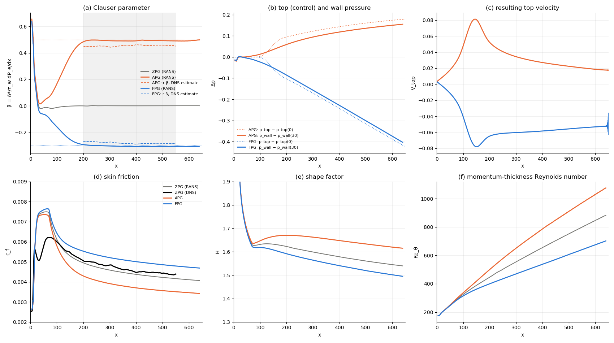
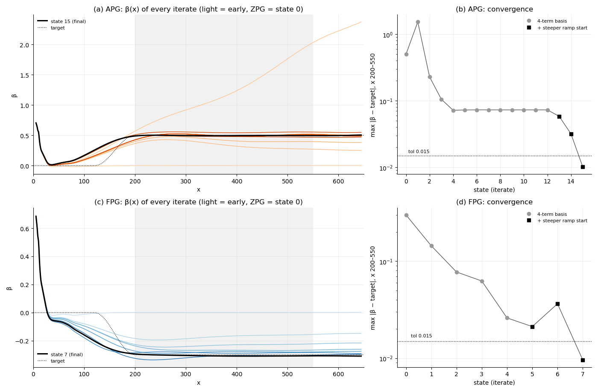

# Adverse-pressure-gradient boundary layer at constant Clauser parameter (2D RANS)

The [`../smooth.RANS`](../smooth.RANS/README.md) layer, with the same plate,
inflow, grid, k-ω SST model, free stream and trip boxes, under an adverse
pressure gradient. The gradient holds the Clauser parameter

    β = δ*/τ_w · dP_e/dx = +0.5

constant from x = 200 (Re_θ ≈ 500, where the layer is turbulent and the
RANS follows the DNS Re_θ(x)) to the end of the box. **Only the top boundary
differs from the ZPG case.** It stays an outlet, but its pressure is the
table [`ptop.txt`](ptop.txt). The table was found by an optimisation loop
around the solver, described under "Procedure". The favourable twin, β = −0.3,
is [`../fpg.RANS`](../fpg.RANS/README.md); it uses the same procedure and
tools. Units as in the DNS: lengths in δ*₀, velocities in U∞, Re_δ*,0 = 450.

The gradient is light, as asked. The layer does not separate: min c_f =
0.0034 against 0.0041 for the ZPG at the outlet. H stays at or below 1.67.

## Results (production grid, 1600 × 384)



`assets/APG_stations.txt` (from `production_170182.h5`, t = 5600):

| x | Re_θ | H | c_f | U_e | β | β_DNS est. | K·10⁶ | V_top |
|---|---|---|---|---|---|---|---|---|
| 150 | 418 | 1.665 | 0.00474 | 0.950 | +0.375 | +0.340 | −1.25 | +0.081 |
| 200 | 500 | 1.670 | 0.00429 | 0.925 | +0.484 | +0.446 | −1.22 | +0.052 |
| 300 | 651 | 1.662 | 0.00391 | 0.887 | +0.492 | +0.444 | −0.87 | +0.034 |
| 400 | 786 | 1.648 | 0.00370 | 0.860 | +0.492 | +0.462 | −0.67 | +0.027 |
| 500 | 911 | 1.633 | 0.00356 | 0.840 | +0.493 | +0.454 | −0.57 | +0.022 |
| 550 | 970 | 1.626 | 0.00351 | 0.831 | +0.491 | +0.451 | −0.53 | +0.020 |
| 640 | 1075 | 1.615 | 0.00342 | 0.817 | +0.499 | +0.458 | −0.47 | +0.018 |

- **β over x = 200–550:** mean +0.493 (min +0.484, max +0.498). It still holds
  at +0.499 at x = 640. The optimiser's target was ±0.015 on the coarse grid;
  see the grid check below.
- **The free stream decelerates.** U_e falls from 0.95 to 0.82, and
  K = ν/U_e² dU_e/dx goes from −1.2·10⁻⁶ to −0.5·10⁻⁶. Re_θ reaches 1075
  at x = 640, against 880 for the ZPG.
- **β_DNS est.** is r·β, where r is the RANS→DNS ratio of β stored in
  [`assets/beta_ratio_zpg.txt`](assets/beta_ratio_zpg.txt) (see below). The
  same top table on the DNS would give β ≈ +0.45. To make the DNS reach a
  target β_DNS, aim the RANS at β_DNS / r.

### Grid check and settling

Production (1600 × 384) against the coarse grid (800 × 192, `coarse_121694.h5`):

- c_f is 1.1–1.45 % higher on the production grid, the same offset as the
  ZPG pair (1.2–1.4 points).
- Re_θ is within 0.4 % and H within 0.002.
- β is 0.004 lower on the production grid (mean +0.493 against +0.497),
  because τ_w is higher.

The coarse grid is therefore the design grid. The table is applied
unchanged on the production grid.

Settling of the production run (t 5100 → 5600):

- β mean and c_f(400) are constant to 0.003 and 0.1 % over the last 300 t.u.
- Over the last 100 t.u., max |Δc_f|/c_f is 0.17 %, at x ≈ 410. This is a
  small local wiggle; the coarse grid is steady to 0.002 %.

## The β ratio RANS → DNS

The [`assets/beta_ratio_zpg.txt`](assets/beta_ratio_zpg.txt) columns are
x, Re_θ(DNS), δ*_DNS/δ*_RANS, τ_w,RANS/τ_w,DNS and r. It is written by
`../smooth.RANS/assets/postpro/beta_ratio.py` from the ZPG pair: the
production RANS `production_62365.h5` and the DNS export.

    r(x) = β_DNS/β_RANS = (δ*_DNS/δ*_RANS) · (τ_w,RANS/τ_w,DNS)

The ratio is taken at the same x and the same dP_e/dx, with δ* computed on
the same edge on both sides.

- **Why the ratio exists.** A top boundary condition imposes dP_e/dx to
  first order, because the inviscid response is the same for both flows.
  The two layers then differ in β only through δ* and τ_w. On x = 200–550,
  r = 0.900 … 0.940 (mean 0.920). The RANS δ* is 2–5 % larger than the
  DNS one, and its τ_w is 3–6 % smaller (the ZPG c_f deficit); the net
  ratio is 0.90–0.94.
- **The assumption behind it.** The ZPG errors of the model are assumed to
  carry over to the mild gradient.

## Procedure

### 1. Definitions (`../smooth.RANS/assets/postpro/pg_bl.py`)

Under a pressure gradient the potential flow above the layer varies with y,
so "U_e = U at the top row" (the ZPG convention) puts the edge in the wrong
place. The edge follows Griffin, Fu & Moin (PRF 6, 2021). The local inviscid
velocity is U_I = √(2(P0_e − p) − V²), and δ₉₉ is where U/U_I = 0.99.
U_e = U_I(δ₉₉), and δ* and θ are integrated from the wall to δ₉₉. P_e is
p(δ₉₉), and its x-derivative is smoothed over 30 δ*₀ (Savitzky–Golay).

**One deviation from Griffin et al.** P0_e is the total pressure of the free
stream *just above the layer*, not that of the top row. The free stream here
is not iso-energetic:

- The Blasius inlet fixes U but not p, so P0 varies across the inlet
  streamlines. The variation is 0.5 % of U² without a gradient and 1.5 %
  under these tables.
- With the top-row P0, U/U_I levels off near 0.991 above an FPG layer, and
  δ₉₉ lands anywhere on that plateau (20 instead of 7.4 at x = 200).

The edge height y_e is the first point, going up, where |∂P0/∂y| < 10⁻³ and
U/U_I,top > 0.9. The free-stream gradient is at most 5·10⁻⁴; inside the
layer it is at least 2·10⁻³. The DNS export, which has no pressure, uses the
same test on U²/2.

### 2. The control: the top pressure, not the top velocity

**The control is p_top(x).** The top boundary stays an outlet, with a
Dirichlet pressure, the predicted normal velocity, and the total-pressure
datum where fluid enters. A new boundary profile reads its pressure from a
table:

```ini
[boundary]
y_max_p_profile = table
y_max_p_value = 1.0
y_max_p_table = ptop.txt   ; x, p_top; linear, constant beyond the ends
```

`_table` works on any face, variable and profile row (`docs/configuration.md`).
p_top(650) = 0, where the top meets the x = 650 outlet, which is held at 0.
The resulting top velocity V_top(x) is an *output*; it is recorded in
[`assets/vtop_result.txt`](assets/vtop_result.txt).

**Prescribing V_top was tried first and fails with this solver.** The test
case was a generic top face with v Dirichlet and p Neumann (`opt/t0`,
deleted 2026-11-16; the numbers below are its record).

- The only Dirichlet pressure left is then the x outlet.
- The iterative projection cannot move the domain-long pressure mode that
  carries the top flux to that outlet.
- The field keeps a 10 % mass imbalance and L2(div) ≈ 3·10⁻³, for any niter
  tested (6, 30, 100).
- With a Dirichlet top, the same change converges like the ZPG case.

### 3. The parametrisation

    dp_top/dx = g(x) = S(x) Σ_{m=0}^{3} a_m ξ^m + a_b (S_b(x) − S(x)),   ξ = (x − 80)/570
    p_top(x) = −∫_x^650 g dx'

- **S** is a half-cosine ramp from 0 at x = 80 to 1 at x = 200.
- **S_b** is the same ramp over 80–160. The term a_b(S_b − S) is a steeper
  start of the ramp; it changes g only for x < 200.
- **Why the bump term is there.** The layer lags the gradient. With the
  ramp ending where the fit starts, the polynomial alone left β(200) at 0.43
  of 0.5, and the maximum error stalled at 0.073 for 8 iterations.
- **Final APG coefficients** (`opt/it14/coeffs.txt`):
  a = (4.46, −8.00, 8.27, −3.80)·10⁻⁴, a_b = 3.69·10⁻³.
- **The target** β(x) ramps over x = 120–200 (half cosine) and is enforced
  on x_fit = 200–550. Downstream of 550 the profile is not fitted, but it
  holds (+0.499 at 640).

### 4. The iteration (`../smooth.RANS/assets/postpro/top_optimise.py opt/case.json`)

Each iterate k (`opt/it<k>/`) goes through four steps.

1. **Evaluate** the previous steady field with `pg_bl`.
2. **Model the response.** The β response to a coefficient change δa is
   modelled as

       δβ = κ · (δ*/τ_w) · R δa

   - R_m is the linear inviscid response of the *wall* pressure gradient to
     the top pressure of basis m. It is a Laplace solution in the 650 × 100
     box: p′ = p_top on the top, 0 at the outlet, uniform at the inlet, and
     ∂p′/∂y = 0 on the wall.
   - δ*/τ_w is taken from the current field.
   - With κ = 1 this is the frozen-layer model, which under-predicts. The
     layer answers an adverse gradient by thickening and losing friction,
     which raises β further. The first APG step, aimed at 0.5, reached 1.2.
   - κ is a secant gain measured on the last step, using the model of the
     *current* state: κ = ⟨δβ_actual, δβ_model⟩ / ⟨δβ_model, δβ_model⟩ on
     x_fit, clamped to [0.3, 5]. Measuring it with the previous state's
     model counts the thickening twice (κ = 3, a step 6× too small).
3. **Solve** for δa by least squares, κ(δ*/τ_w)Rδa = β_target − β on
   [200, 640], and update a += 0.9 δa. The new `ptop.txt` is written.
4. **March to steady.** The solver restarts from the previous field in
   chunks of 250 t.u. until max |Δc_f|/c_f over one chunk (x 30–640) is
   below 0.5 %, with at most 2500 t.u. per iterate.
   - A pressure step travels down the plate at the near-wall speed. After
     500 t.u. the region x > 400 is still adapting, and an update computed
     from such a field chases the transient.
   - The converged iterate is marched on to 0.2 %.
   - The iteration stops when max |β − β_target| on x_fit is at most
     tol = 0.015, or when the error fell by less than 5 % over the last
     three iterates. A stall means the basis, not the iteration, is the
     limit.

### 5. Convergence



[`assets/pg_history.txt`](assets/pg_history.txt) lists every iterate,
re-evaluated with today's edge.

**APG**, max |β − 0.5| by state:

| state | error | what happened |
|---|---|---|
| 0 | 0.499 | the ZPG start |
| 1 | 1.53 | frozen-layer step, κ = 1: overshoot |
| 2 | 0.228 | |
| 3 | 0.105 | |
| 4 | 0.072 | |
| 5–12 | 0.073 | the stall of the four-term basis |
| 13 | 0.058 | + bump term |
| 14 | 0.032 | |
| 15 | 0.010 | |

- **Cost:** 14 500 t.u. on the coarse grid (about 346 000 steps).
- **The changes along the way.** The edge was redefined after state 3 and
  the bump term added after state 12. The optimiser resumed from the last
  field each time; `opt/optimise.log` marks both.
- **FPG** converged in 7 states (8 500 t.u.): 0.301, 0.144, 0.077, 0.063,
  0.026, 0.021, 0.036, 0.010.

### 6. Verification

- **Path independence.** `coarse.ini` restarts the ZPG field
  `../smooth.RANS/coarse_38117.h5` with the final table only. It reaches the
  optimiser's final field to 0.005 % in c_f and 10⁻⁴ in β. It is steady
  about 1750 t.u. after the table is switched on (FPG: 1300). The steady
  state does not depend on the optimisation path.
- **Grid check:** see "Results" above.

## Known features

- **The pressure gradient starts upstream of x = 80.** The wall pressure
  responds elliptically to the top table. The APG c_f peak at the trip is
  about 2 % below the ZPG one; the laminar part and the trip location are
  unchanged.
- **V_top saws near the corner.** V_top has an odd–even sawtooth over the
  last ~25 cells before the top / x-outlet corner.
  - It is confined to the top-face plane and grows about 10× per 10 δ*₀
    toward the corner.
  - It is already present at 10⁻⁵ in the ZPG case and scales with V_top. It
    is visible in the FPG curve of panel (c).
  - The wall quantities are smooth there. Read V_top only up to x ≈ 630.

## Layout

```
ptop.txt            the converged top-pressure table (x, p_top), = opt/it14/ptop.txt
coarse.ini          stage 1: 800 x 192, restart of ../smooth.RANS/coarse_38117.h5 (ZPG) with the table, t 1600 -> 5100
production.ini      stage 2: 1600 x 384 from the interpolated stage-1 field (production_ic.h5), t 5100 -> 5600
run_stages.sh       stage 1 -> interp_restart.py -> stage 2 (log in stages.txt)
assets/
  pg_production.png     beta, p_top / p_wall, V_top, c_f, H, Re_theta against the ZPG (APG + FPG, production grid)
  APG_stations.txt      station table of the production field
  pg_history.png/.txt   the optimisation history of both cases
  beta_ratio_zpg.txt    r = beta_DNS / beta_RANS (x)
  vtop_result.txt       V_top(x) of the converged table (coarse grid)
opt/                the optimisation: case.json, template_p.ini, optimise.log, it0 .. it14
                    (coeffs.txt, ptop.txt, vtop_result.txt, the chunk inis/logs; the fields
                    only for the final iterate, the others deleted 2026-11-16)
```

The tools live in `../smooth.RANS/assets/postpro/`:

| tool | what it does |
|---|---|
| `pg_bl.py` | edge, integrals and β |
| `top_optimise.py` | the loop |
| `pg_report.py` | figure and station tables |
| `pg_history.py` | convergence |
| `beta_ratio.py` | r |
| `interp_restart.py` | field onto another grid |

## Reproduce

The solver needs the `table` boundary profile (2026-11-15). The case files
are the ZPG ones (`[case] file = ../smooth.RANS/*.case.h5`), so run the
smooth.RANS stages first.

```bash
module load toolkits/nvhpc/25.9
export OMPI_MCA_hwloc_base_binding_policy=none
P=../smooth.RANS/assets/postpro

# (optional) the optimisation itself, ~4-8 h on the RTX 3060; writes opt/it*/
cd opt && python3 ../$P/top_optimise.py case.json && cd ..   # "solver" in case.json
cp opt/it14/ptop.txt ptop.txt                                  # the last it<k>/ptop.txt

# the two stages from the table
MOBY_SOLVE=../../../build_gpu/moby_solve ./run_stages.sh

# figures and tables (both cases)
cd .. && python3 $P/pg_report.py apg.RANS/assets/pg_production.png apg.RANS/assets \
    ZPG=smooth.RANS/production_62365.h5 \
    APG=apg.RANS/production_170182.h5:apg.RANS/ptop.txt:0.5 \
    FPG=fpg.RANS/production_170012.h5:fpg.RANS/ptop.txt:-0.3
# needs every iterate's field (deleted here; assets/pg_history.txt is the record)
python3 $P/pg_history.py apg.RANS/assets/pg_history.png APG=apg.RANS/opt:0.5 FPG=fpg.RANS/opt:-0.3
python3 $P/beta_ratio.py smooth.RANS/production_62365.h5 apg.RANS/assets/beta_ratio_zpg.txt
```

**Timings on the RTX 3060.**

- Coarse: 0.035 s/step alone, dt ≈ 0.042. Stage 1 is 83 000 steps.
- Production: 0.072 s/step alone, dt ≈ 0.0103. Stage 2 is 48 000 steps,
  about 1 h alone.
- The 2026-11-15 run took 7 h, sharing the GPU with the FPG case and another
  job.
- The field files, the logs and `opt/it*/` stay local, like the smooth.RANS
  fields.
