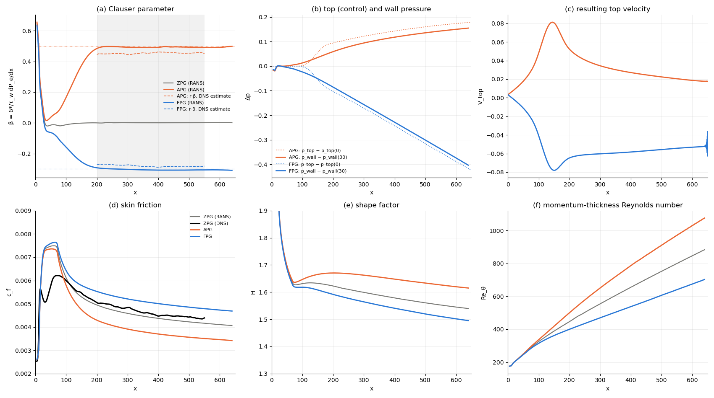

# Favourable-pressure-gradient boundary layer at constant Clauser parameter (2D RANS)

The twin of [`../apg.RANS`](../apg.RANS/README.md), with the target

    β = δ*/τ_w · dP_e/dx = −0.3

held from x = 200 (Re_θ ≈ 400) to the end of the box. Everything except the
top-pressure table [`ptop.txt`](ptop.txt) and the target is shared with the
APG case:

- the set-up: [`../smooth.RANS`](../smooth.RANS/README.md) with the top outlet
  pressure read from a table;
- the edge and β definitions;
- the optimisation procedure, the β ratio, the verification and the known
  features.

All of these are described once, in the APG README ("Procedure").

The gradient is light: K = ν/U_e² dU_e/dx ≤ 1.3·10⁻⁶, well below the
relaminarisation threshold of about 3·10⁻⁶.

## Results (production grid, 1600 × 384)

`assets/FPG_stations.txt` (from `production_170012.h5`, t = 5600):

| x | Re_θ | H | c_f | U_e | β | β_DNS est. | K·10⁶ | V_top |
|---|---|---|---|---|---|---|---|---|
| 150 | 362 | 1.608 | 0.00579 | 1.040 | −0.254 | −0.230 | +1.29 | −0.078 |
| 200 | 400 | 1.591 | 0.00553 | 1.073 | −0.292 | −0.269 | +1.29 | −0.065 |
| 300 | 469 | 1.564 | 0.00521 | 1.138 | −0.303 | −0.273 | +1.09 | −0.060 |
| 400 | 537 | 1.541 | 0.00501 | 1.200 | −0.308 | −0.289 | +0.94 | −0.058 |
| 500 | 606 | 1.520 | 0.00485 | 1.260 | −0.307 | −0.283 | +0.82 | −0.056 |
| 550 | 640 | 1.510 | 0.00479 | 1.289 | −0.306 | −0.281 | +0.76 | −0.054 |
| 640 | 702 | 1.495 | 0.00469 | 1.340 | −0.309 | −0.284 | +0.69 | −0.052 |

- **β over x = 200–550:** mean −0.304 (min −0.308, max −0.292).
- **The free stream accelerates.** U_e rises from 1.04 to 1.34. Re_θ grows
  more slowly than in the ZPG case: 702 at x = 640, against 880.
- **β_DNS estimate.** With the stored ratio r (mean 0.92,
  [`assets/beta_ratio_zpg.txt`](assets/beta_ratio_zpg.txt)), the same table
  on the DNS would give β ≈ −0.28.

**Grid check against the coarse grid** (`coarse_121596.h5`):

- c_f is 1.1–1.35 % higher on the production grid, the ZPG offset.
- Re_θ is within 1.0 % and H within 0.002.
- β mean is −0.304 against −0.306.

**Settling of the production run:**

- max |Δc_f|/c_f over the last 100 t.u. is 0.03 %.
- β mean is constant to 0.001 over the last 300 t.u.

**Optimisation** (`opt/`, coarse grid, history in `assets/pg_history.png` /
`.txt`):

- Seven iterates, 8 500 t.u., with max |β + 0.3| going 0.301 → 0.010.
- Final coefficients (`opt/it6/coeffs.txt`): a = (−4.62, −11.12, 14.97,
  −6.44)·10⁻⁴, a_b = −3.39·10⁻³.
- `opt/optimise.log` marks the edge redefinition (resume at it3) and the
  bump term (from it4).
- The stage-1 run from the ZPG field with the final table reproduces the
  optimiser's field to 0.0002 % in c_f. It is steady about 1300 t.u. after
  the switch.

## Layout and reproduce

As in [`../apg.RANS`](../apg.RANS/README.md):

- `ptop.txt` (= `opt/it6/ptop.txt`), `coarse.ini`, `production.ini`, `run_stages.sh`;
- `assets/` holds `FPG_stations.txt`, `pg_production.png`, `pg_history.png/.txt`,
  `beta_ratio_zpg.txt` and `vtop_result.txt`.

The figures and tables of both cases come from the same commands (APG README,
"Reproduce").

The V_top corner sawtooth (APG README, "Known features") shows here in panel
(c): the last ~25 cells before x = 650. Read V_top only up to x ≈ 630.
