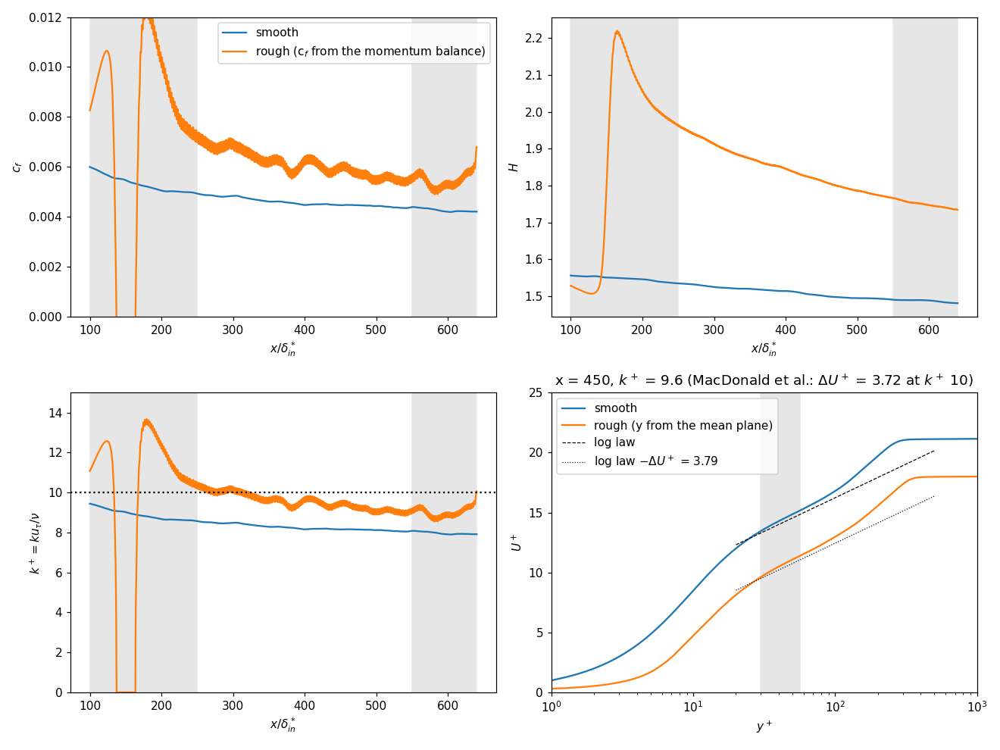

# Rough-wall ZPG turbulent boundary layer (MacDonald egg-carton roughness)

The smooth-wall boundary layer of [`../smooth`](../smooth/README.md) (same domain,
grid, inflow, trip, convection and projection) over an **immersed egg-carton
roughness** adapted from the full-span rough channel of MacDonald, Chan, Chung,
Hutchins & Ooi (JFM 804, 2016, table 1: k⁺ = 10, λ⁺ = 113, ΔU⁺ = 3.72 at
Re_τ = 180). The roughness grows in downstream of the transition and runs
**through the outlet plane**. Units as in the smooth case: lengths in the inflow
displacement thickness δ*₀, velocities in U∞, Re_δ*,0 = 450.

## The case

| ingredient | value |
|---|---|
| everything but the wall | identical to `../smooth/production_stats.ini` (650 × 100 × 26 δ*₀, 3200 × 384 × 136, `cans` y-grid, Blasius inflow, CaNS-exact trip at x = 10, CONS convection, red-black SOR 6) |
| wall surface | `y_w = k + k cos(2πx/λ) cos(2πz/λ)` (`[ibm] wall_shape = eggcarton`): troughs on the domain wall y = 0, mean plane at y = k, crests at 2k |
| k (semi-amplitude) | 0.38348 δ*₀ (crests at 0.767: 50 wall-normal cells) |
| λ | 650/150 = 26/6 = 4.3333 δ*₀ (21 x-cells, 23 z-cells per wave); **k/λ = 10/113 exactly**, solidity (4/π) k/λ = 0.113 |
| roughness extent | grows in over x = 120…160 (`wall_x_start`, `wall_ramp`; transition is complete by x ≈ 80), then uniform **through the outlet** |
| method | volume penalization (IBM) with the analytic surface; the outlet face holds the TOTAL pressure where fluid enters (the backflow datum that makes a body on the outlet plane stable, `docs/next_session_rough_outlet.md`) |
| `cflmax` | 1.0 (`dtmax = 0.02` binds) |

k⁺ follows the local friction velocity of the rough layer: k⁺ ≈ 9–10 over
x = 300–600 (MacDonald et al.'s 10 in the channel).

## Results

Window: **1250 time units** (steps 775 000–837 500) after a 750-unit
flow-through from the restart that switched the roughness on. The smooth
comparison is the smooth tutorial's 1250-unit window. Full output of
`reproduce.py` in [`assets/rough_compare.txt`](assets/rough_compare.txt).



The rough-wall c_f is the **total drag** (form drag included) from the von Kármán
momentum balance, `c_f = 2 dθ/dx + 2(H + 2)(θ/U_e) dU_e/dx`, smoothed over ±50
cells (two wavelengths): the wall-cell velocity is meaningless on the roughness.

| x | 300 | 385 | 450 | 500 | 550 | 600 |
|---|---|---|---|---|---|---|
| k⁺ (rough u_τ) | 10.1 | 9.4 | 9.6 | 9.2 | 9.2 | 8.9 |
| c_f rough | 0.00685 | 0.00594 | 0.00617 | 0.00564 | 0.00567 | 0.00537 |
| c_f smooth | 0.00484 | 0.00455 | 0.00447 | 0.00443 | 0.00440 | 0.00420 |
| ΔU⁺, mean-plane origin | 3.68 | 3.34 | 3.79 | 3.21 | 3.22 | 3.19 |
| ΔU⁺, crest origin | 3.01 | 2.72 | 3.22 | 2.68 | 2.69 | 2.67 |

ΔU⁺ is the Hama roughness function `U⁺_smooth(y⁺) − U⁺_rough(y⁺)`, each side in
its own u_τ, averaged over the log region above the crests (30 < y⁺ < 0.2 δ₉₉⁺).
Mean over the six stations: k⁺ 9.4, **ΔU⁺ = 3.41 ± 0.25** with y measured from
the mean plane (MacDonald et al.'s convention) and 2.83 ± 0.23 from the crests,
against the paper's **3.72 at k⁺ = 10**. The comparison is loose by design:
k⁺ is 6 % under 10 in the transitionally rough regime, a boundary layer is held
against a channel, and the origin alone is worth 0.6. The trend in k⁺ is right
(3.68 at k⁺ 10.1, 3.2 at k⁺ 9).

Also measured (`assets/rough_compare.txt`): dθ/dx falls smoothly from 3.2e-3
to 2.7e-3 over x = 300–630 (smooth side 2.3e-3; c_f ratio 1.25–1.35); the
wall pressure sits 2.7–4.0e-3 above the freestream over the whole rough
region (the form-drag footprint); the outlet adjusts the layer over the last
two cells only. On the outlet plane of the final field 0.28 % of the fluid
faces carry inflow (min −0.12): bounded.

**Not usable**: the ramp-in x = 120–160 (and x < 250 for the integral
balance, where the superficial θ is still adjusting to the displaced
volume), and the outlet zone x > 550, as for the smooth case.

The mean profiles are plane (span) averages that INCLUDE the penalized solid
below the crests (superficial average); above the crests they are fluid
averages. The domain wall y = 0 is the trough level.

## Layout

```
production.ini           phase 1: switch the roughness on, one flow-through (stats off)
production_stats.ini     phase 2: statistics accumulation -> production_stats.h5
reproduce.py             regenerate data.nc, the figure and rough_compare.txt
production_stats_provenance.txt   which run produced the shipped statistics
assets/
  mobydiff/xyz_3200_384_136/data.nc   reduced statistics (committed, res-study format as ../smooth)
  figures/rough_comparison.png        smooth against rough
  rough_compare.txt                   the numbers behind the table above
  postpro/rough_compare.py            momentum balance, k+, Hama roughness function, figure
  postpro/last_column.py              the outlet plane of a field snapshot (backflow, stored pressure)
```

Kept **locally** (too large for GitHub, `.gitignore`d): `production_stats.h5`
and its earlier copy `production_stats_t0.h5` (the shipped window is their
difference), `restart_field.h5` (the final field, step 837 500),
`grid_nodes.h5`, `production_stats_runtime.txt`.

## Reproduce from scratch

The rough case starts from the developed smooth layer, so first run the smooth
tutorial's stage 0 and phase 1 (`../smooth/README.md`, "Reproduce from scratch")
to get `../smooth/production_175000.h5`. Then, in this directory:

```bash
MPI="mpirun -n 4 ../../../build_gpu/moby_solve"      # one rank per GPU
PREP="mpirun -n 4 ../../../build_cpu/moby_prepare"   # same rank count

# phase 1 -- roughness on, 750 t.u. transient (37 500 steps) -> production_212500.h5
$PREP production.ini; $MPI production.ini

# phase 2 -- statistics, 1250 t.u. (62 500 steps) -> production_stats.h5
$PREP production_stats.ini; $MPI production_stats.ini

python3 reproduce.py        # -> data.nc, rough_comparison.png, rough_compare.txt
```

0.198 s/step on 4 A100 (the smooth case 0.180: the penalization costs 10 %),
i.e. ≈ 5.5 h for the two phases. The shipped statistics were run differently
(restart from a smooth field further developed, in 12 500-step chunks; see
`production_stats_provenance.txt`): a from-scratch rerun reproduces them
statistically, not bit for bit. Phase 2 accumulates from zero, so no
`production_stats_t0.h5` is needed for a rerun; to extend the window, restart
`production_stats.ini` from a later `production_p2_*.h5` (the accumulators
continue) and keep a copy of the statistics file at the start of the new window.

History of the case (the first attempts, the outlet instability it exposed and
its fix, the ramped-out fallback): `../smooth/tests_record.md` section 14.
