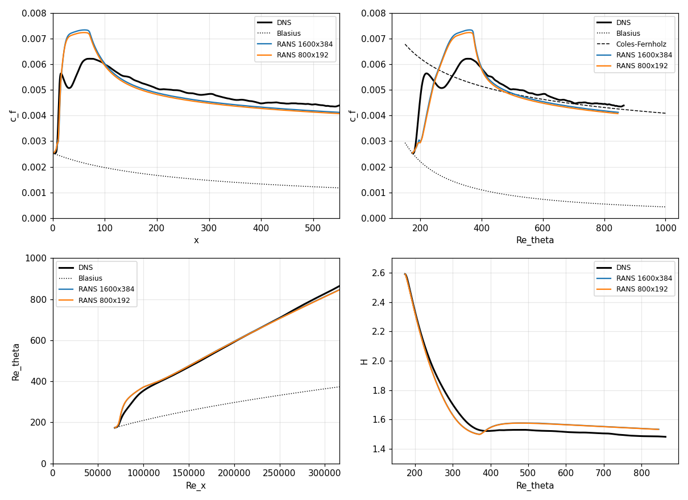
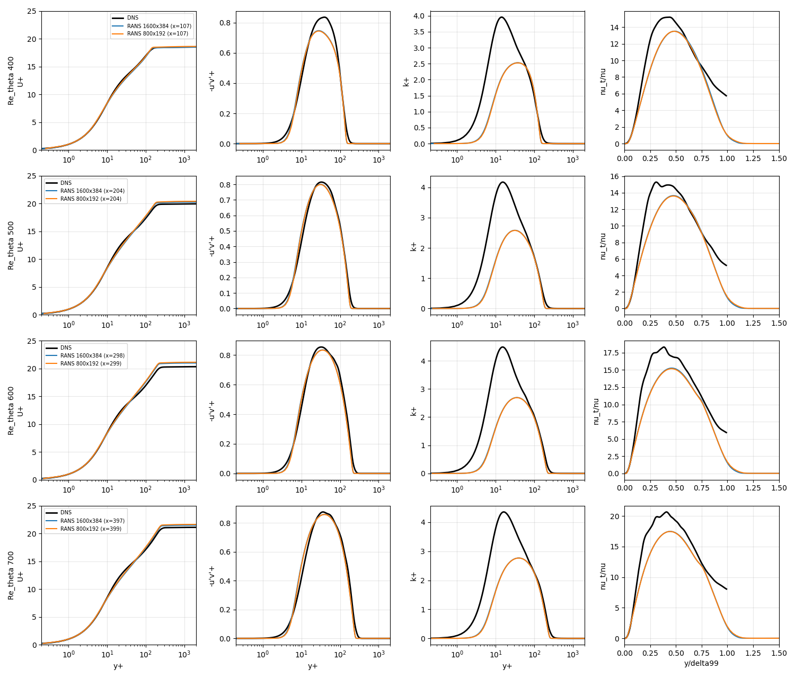
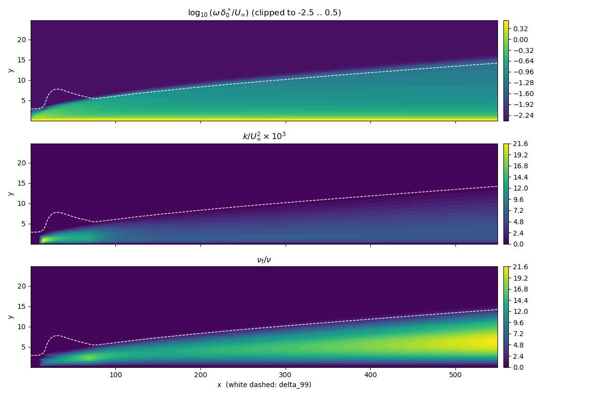
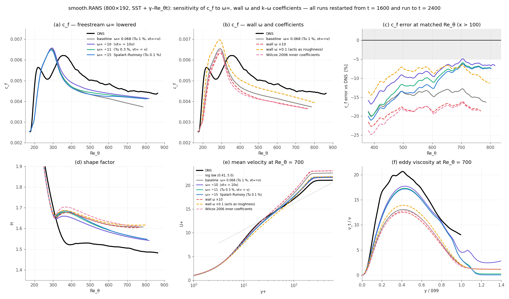
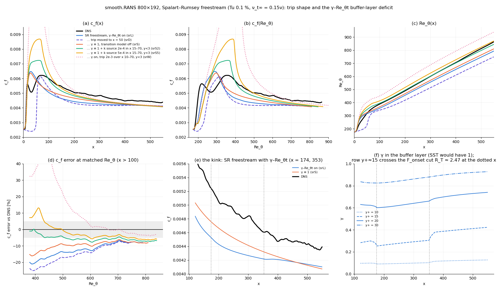

# Smooth-wall ZPG boundary layer: 2D wall-resolved RANS against the DNS

A steady 2D RANS of the [`../smooth`](../smooth/README.md) DNS: the same plate,
domain, inflow and boundary conditions. The layer is laminar (Blasius) up to
the DNS trip, is tripped where the DNS trip acts, and is turbulent downstream.
The model is plain k-ω SST (`src/modules/rans.f90`). Two `[rans]` boxes impose
the laminar → turbulent sequence; the γ–Re_θt transition model was tried and
is off (see "Calibration"). The wall-normal grid reaches y⁺ < 0.15 at the first
cell centre. Units as in the DNS: lengths in the inflow displacement thickness
δ*₀, velocities in U∞, Re_δ*,0 = 450.

## The case

| ingredient | DNS (`../smooth/production_stats.ini`) | RANS (`production.ini`) |
|---|---|---|
| domain | 650 × 100 × 26 | 650 × 100 (× 26, spanwise uniform) |
| grid | 3200 × 384 × 136, `cans` y-stretching 2.822 | **1600 × 384** × 4: the DNS y-grid itself, every 2nd DNS x node. Grid check: 800 × 192 (`coarse.ini`) |
| inflow | Blasius at Re_δ* = 450, laminar free stream | the same Blasius profile; k∞ = 1.5·10⁻⁶ (Tu = 0.1 %), ν_t∞ = 0.15 ν (ω∞ = 0.0045), held by the ambient sustaining sources |
| wall, top, outlet | no-slip; outlets at y = 100 and x = 650 | the same (k = 0 and ω = 6ν/(β₁y²) on the wall; zero-gradient k, ω at the outlets) |
| trip | random wall-normal volume force at x₀ = 10 (Gaussian lx = 4, ly = 1) | **forced laminar** (k ≡ 0) for x < 10, y < 20; a **k source** of 0.002 U∞³/δ*₀ in x = 10–15, y < 2, and a weak one of 2·10⁻⁴ in x = 15–70, y < 3 |
| transition | resolved | imposed by the boxes (`[rans] transition = false`) |
| convection | conservative, 2nd order | the same for momentum; 1st-order upwind for k, ω |
| time | statistics over 1250 t.u. | time-marched to the steady state (c_f changes < 0.2 % over the last 130 t.u.) |

The spanwise direction keeps 4 cells only because a block needs 4. With no
trip forcing and no spanwise variation, the solution is exactly 2D. dz is
large on purpose: it would otherwise enter the Courant and Peclet sums.

### Laminar → trip → turbulent

- **Free stream.** The DNS free stream is laminar. The RANS one carries the
  ambient values Spalart & Rumsey (AIAA J. 45, 2007) recommend for this
  situation: k∞ = 1.5·10⁻⁶ U∞² (Tu = 0.1 %) and ν_t∞ = 0.15 ν, so ω∞ =
  0.0045 U∞/δ*₀. Their criterion is that ω∞ stays well below the outer-layer
  ω ≈ U∞/δ (0.07–0.15 here). A larger ω∞ leaks into the layer edge and
  starves the outer eddy viscosity (Calibration, item 2).
- `kpin_box = -1 10 -1 20 -1 30` pins k = 0 upstream of the DNS trip centre,
  through the layer and well above it. The layer there is exactly Blasius.
- `ktrip_box = 10 15 -1 2 -1 30 0.002` injects turbulence kinetic energy
  inside the layer (δ₉₉ ≈ 3 at x = 10), where the DNS forcing acts. It is
  the smallest tested rate that does not relaminarize (Calibration, item 1).
- `ktrip_box = 15 70 -1 3 -1 30 2.0e-4` keeps a weak source on up to the
  DNS c_f peak (x = 70). It stands in for the DNS's slow transitional
  overshoot. Without it the RANS layer relaxes to equilibrium within a few δ
  of the trip, and Re_θ falls about 40 behind the DNS by x = 550. With it
  Re_θ(x) follows the DNS to about 2 % from x = 100 on (Calibration, item 5).

## Results

`reproduce.py` → `assets/rans_vs_dns.txt` and the three figures. Production
grid, step 62365 (t = 1850), against the DNS at the same x:

| x | Re_θ RANS | DNS | c_f RANS | DNS | err | H RANS | DNS | Re_τ RANS | DNS |
|---|---|---|---|---|---|---|---|---|---|
| 30 | 309 | 266 | 0.00712 | 0.00508 | +40 % | 1.60 | 1.86 | 208 | 83 |
| 50 | 346 | 317 | 0.00731 | 0.00578 | +26 % | 1.52 | 1.64 | 182 | 121 |
| 70 | 372 | 354 | 0.00727 | 0.00621 | +17 % | 1.50 | 1.55 | 152 | 146 |
| 100 | 395 | 388 | 0.00601 | 0.00599 | +0.4 % | 1.54 | 1.52 | 149 | 162 |
| 150 | 442 | 437 | 0.00522 | 0.00546 | −4.5 % | 1.57 | 1.53 | 167 | 181 |
| 200 | 496 | 489 | 0.00488 | 0.00505 | −3.3 % | 1.58 | 1.53 | 184 | 197 |
| 300 | 603 | 600 | 0.00453 | 0.00484 | −6.3 % | 1.57 | 1.51 | 217 | 235 |
| 400 | 703 | 705 | 0.00433 | 0.00447 | −3.2 % | 1.55 | 1.51 | 247 | 267 |
| 500 | 799 | 812 | 0.00418 | 0.00443 | −5.6 % | 1.54 | 1.49 | 276 | 300 |
| 550 | 846 | 864 | 0.00412 | 0.00439 | −6.1 % | 1.53 | 1.48 | 290 | 316 |

c_f at matched Re_θ (x > 100):

| Re_θ | 400 | 500 | 600 | 700 | 800 |
|---|---|---|---|---|---|
| 1600 × 384 | +0.4 % | −3.1 % | −6.2 % | −3.5 % | −6.0 % |
| 800 × 192 | −0.9 % | −4.5 % | −7.4 % | −4.8 % | −7.2 % |



What the RANS reproduces:

- **The laminar inflow and the trip location.** Up to x = 10 the layer is
  Blasius, and the rise of c_f starts where the DNS one does.
- **Re_θ(x) downstream of the trip region.** It is within about 2 % of the
  DNS from x = 100 to 550, so a comparison at the same x and at the same
  Re_θ give the same picture.
- **The turbulent skin friction to 3–6 %** from Re_θ = 450 on (x ≥ 150).
  The wiggles in the error are the DNS's own c_f scatter.
- **The near-wall layer.** U⁺ agrees with the DNS within 0.2 up to y⁺ = 10
  and within 0.5 at y⁺ = 30. The peak of −u′v′⁺ (= ν_t ∂U/∂y in the RANS)
  is 2 % low from Re_θ = 600 on (11 % low at 400, still in the trip region).
- **Grid independence.** The two grids differ by 1.2–1.4 points in c_f (the
  fine grid higher) and by at most 2 in Re_θ. The 800 × 192 grid is enough,
  and the stated errors are the model's.

What it does not reproduce:

- **The transitional c_f in x = 15–90.** The two k sources make the layer
  turbulent at once and hold it there: c_f is a plateau of 0.0071–0.0073
  over x = 20–70, where the DNS goes through its dip (0.0051 at x = 31) and
  its overshoot (0.0062 at x = 70). The plateau is the price of matching
  Re_θ downstream; a RANS does not resolve the DNS breakdown.
- **The wake.** H is 1.54–1.57 against 1.49–1.53, and U_e⁺ = √(2/c_f) sits
  0.4–0.7 higher from Re_θ = 600 on. The outer eddy viscosity is 10–20 %
  below the DNS's −u′v′/(∂U/∂y) (see the profiles).



The profiles at matched Re_θ:

- **U⁺** agrees through the buffer layer. From y⁺ ≈ 50 the RANS rises
  faster: +0.6 at y⁺ = 100 for Re_θ = 600 and 800.
- **ν_t/ν** has the DNS shape but peaks 11–20 % lower (15.3 against 18.3 at
  Re_θ = 600, 17.5 against 20.7 at 700). It decays to zero at δ₉₉, where the
  DNS still has 6–8: SST has no intermittent-edge mixing.
- **k⁺ is not comparable.** The model k peaks at 2.5–2.8 against the DNS's
  4.0–4.5. An eddy-viscosity k does not carry the buffer-layer u′² peak, and
  k does not enter c_f except through ν_t = a₁k/max(a₁ω, S F₂).



The maps show the trip region: k from the strong source at x = 10–15, its
decay along the weak source to x = 70, and the free stream at the sustained
ω∞ above the layer. The white dashed line is δ₉₉. Its bump at x = 15–120 is
a definition effect, not the layer. U_e is U at the top row, as in the DNS
export, and the potential flow just above the tripped layer is 0.5–1 %
slower than at the top (the displacement of the trip region), so the 0.99
threshold lands in that slowly varying outer flow.

## Calibration

Everything below was run on 800 × 192, restarted from a converged field and
marched for 800–2000 t.u. to a new steady state, with the errors taken at
matched Re_θ. The runs themselves are scratch (not committed); the two
figures are copies of their plots, not regenerated by `reproduce.py`.

**1. Trip strength** (the original short-domain test: x ≤ 120, 216 × 192,
γ–Re_θt on, Tu = 1 %; c_f at x = 30 / 70 / 110, DNS 0.0051 / 0.0062 /
0.0059):

| k box (x) | rate | outcome |
|---|---|---|
| 10–15 | 2·10⁻⁴ | relaminarizes: c_f 0.0029 → 0.0021 |
| 10–15 | 5·10⁻⁴ | relaminarizes: c_f 0.0037 → 0.0023 |
| 10–15 | 1·10⁻³ | weak: c_f 0.0052 / 0.0047 / 0.0040, decaying |
| **10–15** | **2·10⁻³** | **turbulent: c_f 0.0066 / 0.0056 / 0.0049** |
| 10–20 | 1·10⁻³ | turbulent, as 2·10⁻³ over 10–15 |
| 15–20 (laminar to 15) | 2·10⁻³ | turbulent, Re_θ lags further |

**2. Freestream ω.** First setup: γ–Re_θt on, one k box, Tu = 1 %, ν_t∞ = ν,
so ω∞ = 0.068 ≈ U∞/δ.

| freestream | ω∞ | c_f error at Re_θ 400 / 500 / 600 / 700 / 800 | H at x = 550 |
|---|---|---|---|
| Tu 1 %, ν_t∞ = ν (first setup) | 0.068 | −19 / −14 / −15 / −13 / −17 % | 1.61 |
| Tu 1 %, ν_t∞ = 0.1 ν | 0.68 | about −50 %, nearly relaminarized | 2.07 |
| Tu 1 %, ν_t∞ = 10 ν | 0.0068 | −16 / −9 / −9 / −5 / −7 % | 1.54 |
| Tu 0.3 %, ν_t∞ = ν | 0.0061 | −19 / −12 / −11 / −6 / −7 % | 1.55 |
| Tu 0.1 %, ν_t∞ = 0.15 ν (Spalart–Rumsey) | 0.0045 | −20 / −14 / −13 / −7 / — % | 1.55 |

ω∞ is the lever. At ω∞ ≈ U∞/δ the free stream holds the edge ω up, and the
outer ν_t is 30–40 % low; the damage grows downstream as δ grows. Below
about ω∞/10 the result no longer depends on the value: 0.0061 and 0.0045
agree within 2 points. The extra points of the ν_t∞ = 10 ν row upstream come
from its lower Re_θt (item 4), not from the freestream eddy viscosity.

**3. Wall ω and the k-ω coefficients** (first setup):

| change | c_f error at Re_θ 400 / 500 / 600 / 700 / 800 |
|---|---|
| wall ω × 10 | −22 / −18 / −19 / −16 / −20 % |
| wall ω × 0.1 | −14 / −7 / −9 / −7 / −12 %, by a roughness-like U⁺ shift of −0.7 from y⁺ ≈ 5 |
| Wilcox (2006) inner set: β₀ 0.0708, α 0.52, σ_k 0.6, σ_d 1/8 | −24 / −18 / −19 / −17 / −20 % |

None helps without breaking something else. No published SST recalibration
for low Re_θ was found.

**4. The transition model.** With the trip boxes in place, γ–Re_θt adds only
a defect. In the turbulent layer its onset function F_onset is cut where R_T
= k/(νω) < 2.47, and γ destruction is active where R_T < 4. The buffer
layer sits exactly there: γ is about 0.1 at y⁺ = 10, 0.3 at y⁺ = 15 and 0.65
at y⁺ = 20, where SST would have 1. That trims k production where it peaks.
The level depends on the Re_θt carried into the layer, so it is worst at the
lowest Tu. As the layer grows, the cell row at y⁺ ≈ 15 crosses the R_T
threshold, its γ production switches off or on, γ steps, and c_f(x) gets a
kink (x = 174 and 353 at Tu = 0.1 %). With `transition = false` and the same
boxes, c_f gains 3–5 points at Re_θ 400–600, the kinks vanish, and the run
converges in about half the time (no slow Re_θt transport).

**5. Trip shape** (Spalart–Rumsey free stream):

| trip | c_f error at Re_θ 400 / 500 / 600 / 700 / 800 | c_f peak (x) |
|---|---|---|
| γ–Re_θt on, k box 10–15 | −20 / −14 / −13 / −7 / — % | 0.0065 (29) |
| γ–Re_θt on, laminar to 50, k box 50–55 | −25 / −17 / −14 / −8 / — % | 0.0061 (68) |
| γ–Re_θt on, 2·10⁻³ over x 10–70, y < 3 | +36 / +22 / +2 / 0 / −4 % | 0.0136 (52) |
| SST, k box 10–15 | −15 / −9 / −10 / −6 / −8 % | 0.0064 (28) |
| **SST, k box 10–15 + 2·10⁻⁴ over 15–70, y < 3** | **−1 / −5 / −7 / −5 / −7 %** | **0.0072 (61)** |
| SST, k box 10–15 + 5·10⁻⁴ over 15–70, y < 3 | +10 / 0 / −5 / −3 / −6 % | 0.0087 (64) |

Moving the trip so that the RANS peak sits on the DNS peak (x = 70) matches
the peak but not the layer: the RANS relaxes after it as fast as before, and
the longer laminar run makes Re_θ lag more. A weak source over the DNS
transition region instead brings Re_θ(x) onto the DNS. At fixed x far
downstream, c_f is the same for every trip (≈ 0.0041 at x = 550 against
0.0044); the trip only shifts Re_θ.





## Layout

```
coarse.ini          stage 1: 800 x 192 from scratch, t = 0 -> 1600 (~22 min, RTX 3060)
production.ini      stage 2: 1600 x 384 from the interpolated stage-1 field, t = 1600 -> 1850 (~30 min, RTX 3060)
reproduce.py        the table and the three figures from the final fields of both stages
assets/
  rans_vs_dns.txt               station table, c_f at matched Re_theta (both grids)
  figures/rans_vs_dns.png       c_f(x), c_f(Re_theta), Re_theta(Re_x), H(Re_theta)
  figures/rans_profiles.png     U+, -u'v'+, k+, nu_t/nu at Re_theta 400 / 500 / 600 / 700
  figures/rans_maps.png         log10 omega, k, nu_t/nu in (x, y)
  figures/calib_*.png           the calibration runs (scratch; see "Calibration")
  postpro/rans_bl.py            reader + the DNS export's integral definitions + figures
  postpro/interp_restart.py     a converged field onto another grid of the same domain (restart IC)
```

The DNS reference is `../smooth/assets/matlab/tbl_dns_smooth.mat`, written by
`../smooth/assets/matlab/export_mat.py` from the DNS statistics. Both are
local only, like the field snapshots of this case.

## Reproduce from scratch

```bash
module load toolkits/nvhpc/25.9
export OMPI_MCA_hwloc_base_binding_policy=none
PREP="mpirun -n 1 ../../../build_cpu/moby_prepare"
SOLVE="mpirun -n 1 ../../../build_gpu/moby_solve"

# stage 1 -- coarse grid from scratch -> coarse_<N>.h5 at t = 1600 (steady from t ~ 1300)
$PREP coarse.ini && $SOLVE coarse.ini
# stage 2 -- the production grid from the interpolated coarse field
$PREP production.ini
python3 assets/postpro/interp_restart.py $(ls -v coarse_*.h5 | grep -v case | tail -1) production.case.h5 production_ic.h5
$SOLVE production.ini
python3 reproduce.py        # needs ../smooth/assets/matlab/tbl_dns_smooth.mat
```

One GPU rank is enough: the 2D problem is small. The step is diffusion-bound
by the first wall cell (Peclet 0.5 with ν + ν_t; dt ≈ 0.042 on 800 × 192,
0.0103 on 1600 × 384). Timings: 0.035 s/step (coarse) and 0.072 s/step
(production) on an RTX 3060, whose fp64 is slow. A data-centre GPU is many
times faster. The CPU build works with `mpirun -n 4` (`nb` gives 4 blocks on
the coarse grid, 8 on the production grid) but is several times slower than
the 3060. Stage 1 from scratch and a restart of the same setup from another
converged field give the same c_f to 0.002 %.

The RANS inlet must hold the configured k∞. Before the 2026-11-13 fix in
`src/modules/rans.f90`, the freestream k on a Blasius inlet face was doubled.
The `_value` of every Blasius row is U∞ itself, and the u and v rows were
summed as velocity components. The inlet then carried k = 2 k∞.
