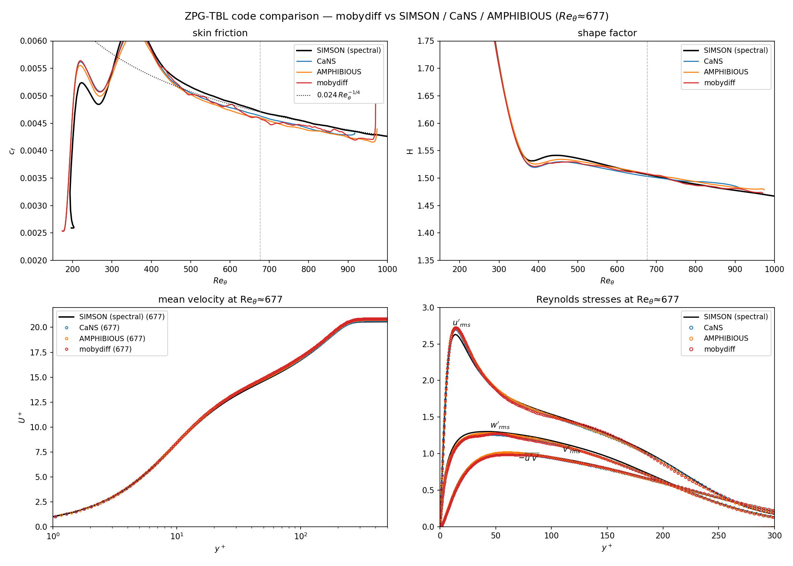

# Turbulent zero-pressure-gradient boundary layer (ZPG TBL)

A spatially-developing incompressible **ZPG turbulent boundary layer** DNS,
non-dimensionalised by the inlet displacement thickness (Re_δ*,0 = 450, U∞ = 1).
This is a **direct, apples-to-apples reproduction of the CaNS and AMPHIBIOUS
reference DNS** — the *same* domain, resolution, grid, and trip — so mobydiff's
result can be held against theirs with nothing else varying, and against the
**SIMSON** pseudo-spectral code as an independent spectral reference.

(The earlier trip / resolution / solver study that led here — including a finer
in-house grid — is kept in **[`tests_record.md`](tests_record.md)**.)

## The case (identical to CaNS `xyz_3200_384_135`)

| ingredient | value | matches |
|---|---|---|
| domain | 650 × 100 × 26 δ*₀ | CaNS `l = 650, 100, 26` |
| resolution | 3200 × 384 × **136** | CaNS `ng = 135` (see note below) |
| x, z grid | uniform (Δx = 0.203, Δz = 0.191) | CaNS (Δz = 0.193) |
| **y grid** | one-sided tanh, `stretch = 2.822` (`distribution = cans`) | CaNS `gtype = 2, gr = 2.822` — reproduced to 5.6e-6 (their float32 rounding) |
| Re_δ*,in | 450 | CaNS `visci` |
| trip | Schlatter–Örlü, **CaNS-exact port**, `trip_amp = 0.18854`, `x0 = 10`, `nmodes = 16` | CaNS/AMPHIBIOUS `trip_*` (`src/modules/bodyforce.f90`) |
| convection | **conservative (CONS / divergence)** | CaNS / AMPHIBIOUS momentum form |
| pressure solver | red-black SOR, `niter = 6`, `sor = 1.5` | AMPHIBIOUS (same projection) |
| BCs | inlet/outlet x, periodic z, no-slip wall + pressure-pinned top | CaNS `cbcvel/cbcpre` |

The `cans` (one-sided tanh) grid distribution was added to the solver for this
(`init.f90` `GRID_TANH_WALL`): `y = L·[1 + tanh(a(s−1))/tanh(a)]`, `a = stretch`.

> **Spanwise `nz = 136`, not 135.** The reference grid is `nz = 135`, but
> mobydiff's red-black SOR needs **even** global sizes in periodic directions
> (checkerboard consistency across the periodic wrap). `nz = 135` is odd, so we use
> `nz = 136` at the **same** `Lz = 26`: the domain is byte-identical to the
> references, only the spanwise cell count ticks up by one (Δz 0.193 → 0.191,
> ~0.7 %, negligible for a spanwise-homogeneous statistic). To run the literal
> `nz = 135` grid instead, switch `[pressure] solver` to the default
> damped-Jacobi/Chebyshev (no even constraint) — closer to CaNS's exact FFT
> projection, but no longer mirroring AMPHIBIOUS's red-black SOR.

> **Convection — CONS vs skew.** This case uses the **conservative (divergence)**
> momentum convection to mirror CaNS/AMPHIBIOUS exactly (`[flow] convection =
> divergence`). The conservative form is kept for **testing/research**: it is not
> energy-neutral under the incremental projection, so watch the divergence residual
> on a long run (here `L2_div` stayed bounded at 2.5e-5–1.2e-4 over the full
> 10 000 t.u. statistics window — no drift, as AMPHIBIOUS's own CONS runs at
> `niter = 6`). The solver's **default production form is skew-symmetric**; a skew
> variant (`production_skew.ini` / `production_stats_skew.ini`) is provided to
> compare against AMPHIBIOUS's skew-symmetric dataset.

## Code comparison — SIMSON / CaNS / AMPHIBIOUS

All codes share the nondimensionalization (Re_δ*,in = 450), so the flow is compared
directly at a matched **Re_θ ≈ 677**. With the CaNS-exact trip the **transition
region matches too** — a clean monotone rise to a single c_f overshoot, not the
old weak-trip spike-then-dip (see `tests_record.md`).



| code | grid (nx·ny·nz) | c_f | H | u_τ | u′_rms peak | −u′v′ peak |
|---|---|---|---|---|---|---|
| SIMSON (spectral) | 3072·301·— | 0.00471 | 1.507 | 0.0485 | 2.631 | 0.882 |
| CaNS | 3200·384·135 | 0.00463 | 1.503 | 0.0481 | 2.706 | 0.874 |
| AMPHIBIOUS | 3200·384·135 | 0.00460 | 1.508 | 0.0479 | 2.723 | 0.899 |
| **mobydiff** | **3200·384·136** | **0.00458** | **1.508** | **0.0479** | **2.724** | **0.848** |

On the identical grid / domain / trip / numerics, **mobydiff lands inside the
CaNS–AMPHIBIOUS scatter on every quantity** — c_f 0.00458 (−1.1 % vs CaNS, −0.4 %
vs AMPHIBIOUS), and u′_rms peak 2.724 at AMPHIBIOUS's 2.723. The
mean U⁺(y⁺) and the Reynolds stresses of all four codes overlay through the
sublayer, log region and wake. **Two takeaways:**

- **On the reference setup, mobydiff reproduces CaNS/AMPHIBIOUS** — as it must,
  since the same grid and trip drive the same developed layer. The three
  finite-volume/difference codes cluster tightly (c_f ≈ 0.0046, ~2 % below SIMSON).
- **The near-wall u′_rms peak sits ~3 % above SIMSON for _all three_ non-spectral
  codes** (mobydiff 2.72, CaNS 2.71, AMPHIBIOUS 2.72). This overshoot is a generic
  second-order finite-volume/difference signature relative to a spectral method,
  **not** a mobydiff artifact. (A finer in-house grid narrows the c_f gap to SIMSON
  to ~0.4 %; see `tests_record.md`.)

> **AMPHIBIOUS curve caveat.** AMPHIBIOUS's *conservative*-convection datasets are
> not published on the LSDF share — only the skew-symmetric ones are — so the
> AMPHIBIOUS curve above is `TRIP_SKEWSYM_CENTERED` (same centered differencing and
> numerics, skew instead of CONS convection). CaNS is the direct CONS reference.

STANDS in the 2026-10 re-validation pass (`docs/next_session_revalidation.md`,
ledger closed 2026-10-24): the numbers below were measured 2026-10-05/06/08 on
main with the predicted outlet, post-F1, and were not re-run at the pass's
Chebyshev-12 convention because this case runs red-black `niter = 6` by
design (AMPHIBIOUS's projection).

The table is the **1250-time-unit window** (steps 712 500–775 000) of the
2026-10-05/06 rerun of this case on main with the PREDICTED outlet face
(`docs/next_session_outlet.md`; HoreKa, 4 A100, `tests_record.md` section 14),
restarted from the developed field of the 10 000-unit old-outlet campaign of
the branch that built the case and run for 2000 units, the first flow-through
(750 units) discarded as the transient of the outlet change
(`production_stats_provenance.txt`). Against the superseded 10 000-unit
old-outlet statistics the station values move by sampling: c_f within ±1.4 %
at every station up to x = 550, the −u′v′⁺ peak's band mean over x = 350–420
0.875 against 0.872 (its station-to-station scatter in a 1250-unit window is
0.024, in the 10 000-unit data 0.004); the comparison station x ≈ 385
(Re_θ ≈ 677) is 265 δ*₀ from the outlet. Only x > 600 differs
systematically, where the old outlet stalled the layer (next section).
A rough-wall variant of the case was run alongside: it is the tutorial
[`../rough_macdonald`](../rough_macdonald/README.md) (history in
`tests_record.md` section 14).

The mobydiff comparison data, in the same NetCDF format as the reference files, is
committed at **`assets/mobydiff/xyz_3200_384_136/data.nc`**.

## The outlet zone

Do not use the last stretch of the plate. How long that stretch is depends on
the outlet treatment, and it was measured on the EARLIER in-house grid
(4096 × 224 × 192 on 750 × 100 × 32, `tests_record.md`; 2026-10-02 and
2026-10-04, `assets/postpro/momentum_integral.py`: the growth of the momentum
thickness against `c_f/2 − (H+2)(θ/U_e) dU_e/dx`, and the mean wall pressure,
per x band). The x bands below are on that 750-long domain. Two data sets: the
old outlet (the face reset to its neighbour every substage, 500 time units
after a 250-unit settling, 4 GPUs) and the predicted face (10 000 time units):

| x band | old outlet: dθ/dx | balance | p_wall | shipped: dθ/dx | balance | p_wall |
|---|---|---|---|---|---|---|
| 450 … 600 | 2.0 … 2.3e-3 | 2.2 … 2.3e-3 | +2e-4 | 2.2 … 2.3e-3 | 2.2 … 2.2e-3 | −1e-4 |
| 650 … 680 | 1.8e-3 | 2.1e-3 | −4.0e-4 | 2.2e-3 | 2.1e-3 | +1.5e-4 |
| 700 … 715 | 1.0e-3 | 2.0e-3 | −1.5e-3 | 2.4e-3 | 2.1e-3 | +4.4e-4 |
| 730 … 740 | 4.0e-4 | 2.0e-3 | −2.2e-3 | 2.4e-3 | 2.0e-3 | +8.6e-4 |
| 745 … 748 | 2.2e-4 | 2.0e-3 | −2.8e-3 | 2.7e-3 | 2.0e-3 | +9.5e-4 |
| 749.5 … 750 | 6e-5 | 2.0e-3 | −3.0e-3 | 4.3e-3 | 2.2e-3 | +1.4e-4 |

- **Old outlet** (every data set before 2026-10-04, the committed elected-case
  statistics included): the wall pressure falls toward the
  outlet and the momentum thickness stops growing over the last ~100 δ*₀
  (5 δ₉₉); the freestream pressure does not move. A zero-pressure-gradient
  layer has `p_wall = p_e`: this was the outlet pressure mode, time averaged.
- **Predicted face** (main since 2026-10-01): the balance holds within 5 % up to
  x = 650, within 15 % to 715 and within 20 % to 740, under a wall pressure
  that rises by 1e-3 over the last 60 units (a mild adverse gradient the
  freestream does not see); the last 2 δ*₀ adjust to the uniform outlet
  pressure (the mean pressure inside a turbulent layer is `−⟨v′v′⟩`, the face
  value 0): c_f rises 14 % there, most of it in the last cell. The stored
  pressure of the last column is 100 times quieter and the divergence
  residual of the 6-iteration red-black projection 5 times lower (3e-6).
- **Use x ≤ L_x − 100** for anything quantitative (on the elected 650-long
  domain, x ≤ 550, Re_θ ≤ 840; the comparison station Re_θ ≈ 677 is at x ≈ 385).

**Measured on the elected grid** (the shipped 1250-unit window,
`../rough_macdonald/assets/postpro/rough_compare.py --smooth production_stats.h5
production_stats_t0.h5`, same conventions, dθ/dx against the balance per
band): within 3–4 % from x = 300 to 600 (the sampling scatter of a 1250-unit
window on a 50-unit band), then

| x band | dθ/dx | balance | p_wall | p_e |
|---|---|---|---|---|
| 550 … 600 | 2.24e-3 | 2.16e-3 | +4e-5 | +6e-5 |
| 600 … 630 | 2.56e-3 | 2.11e-3 | +3.3e-4 | +7e-5 |
| 630 … 640 | 2.50e-3 | 2.09e-3 | +9.3e-4 | +5e-5 |
| 640 … 648 | 2.5e-3 | 2.1e-3 | +1.1e-3 | +2e-5 |
| 648 … 649.5 | 3.3e-3 | 2.2e-3 | +6.4e-4 | +4e-6 |
| 649.5 … 650 | 4.3e-3 | 2.3e-3 | +1.4e-4 | +7e-7 |

The adjustment zone is the last ~2 δ₉₉ (δ₉₉ ≈ 20–24 there): +20 % on the
growth from x = 600 under a wall pressure that rises by 1e-3 (the freestream
pressure stays below 1e-4), +50 % over the last two cells. The same shape as
on the 750-long in-house grid. The stored pressure of the last column is
6x quieter than an interior column's (final field: rms over the plane 4.8e-4
against 2.7–3.1e-3 at x = 325 and 640; the face holds the datum), and no face
of the plane carries inflow in it.

## Layout

```
cold_start.ini           stage 0: from-scratch laminar->turbulent (-> coldstart_100000.h5)
production.ini           phase 1: re-equilibration, CONS convection (stats off)
production_stats.ini     phase 2: statistics accumulation -> production_stats.h5
production_skew.ini      phase 1, skew variant (-> skewsym_175000.h5)
production_stats_skew.ini   phase 2, skew variant -> skewsym_stats.h5
reproduce.py             regenerate assets/mobydiff/*.nc + the figure from the statistics
tests_record.md          the trip / resolution / solver study behind this case
assets/
  mobydiff/xyz_3200_384_136/data.nc   our reduced statistics (committed, res-study format)
  figures/code_comparison.png         the committed comparison figure
  postpro/                            post-processing + grid/IC tooling (below)
  matlab/                             the statistics as ONE MATLAB file for external
                                      validation: export_mat.py writes tbl_dns_smooth.mat
                                      (local), read_tbl_dns.m reads and plots it
```

Large data are **kept locally** (all exceed GitHub's 100 MB limit), listed in
`.gitignore` and regenerable:

- `coldstart_*.h5`, `production_*.h5` — field snapshots the run writes,
- `production_stats.h5`, `production_stats_t0.h5` — the raw span+time statistics
  (cumulative) and its earlier copy; the shipped window is their difference,
- `restart_field.h5` — the last field of the shipped run (restart point),
- `grid_nodes.h5` — the grid node lines (for `make_mobydiff_nc.py`),
- `assets/postpro/passivewall.hdf5` — the SIMSON spectral reference.

The **CaNS / AMPHIBIOUS** reference data live on the group LSDF share
(`.../tbl-dns/res_study/data_processed/{cans,amphibious}/*/data.nc`); the committed
mobydiff `data.nc` is in the identical format so the comparison is symmetric.

## Reproduce from scratch

No large input file is needed — the grid, the Blasius inflow and the trip forcing
are all generated by the solver from the `.ini`. The case is 165 M cells, a
multi-day GPU campaign (≈ 0.18 s/step on 4× A100).

```bash
# build (see the repo README): ./compile.sh gpu   (or cpu)
MPI="mpirun -n 4 ./build_gpu/moby_solve"      # one rank per GPU
PREP="mpirun -n 4 ./build_cpu/moby_prepare"   # the case file of each ini, once, SAME rank count

# stage 0 — cold start: laminar Blasius + strong trip -> turbulent, ~2000 t.u.
$PREP cold_start.ini; $MPI cold_start.ini      # -> coldstart_100000.h5

# phase 1 — re-equilibrate under the CaNS production trip (CONS), ~1500 t.u.
$PREP production.ini; $MPI production.ini      # -> production_175000.h5

# phase 2 — accumulate statistics, ~10000 t.u. (500000 steps, ~25 h on 4 A100) -> production_stats.h5
$PREP production_stats.ini; $MPI production_stats.ini
```

(For the skew-symmetric variant, run `production_skew.ini` then
`production_stats_skew.ini` from the same `coldstart_100000.h5`.)

Then regenerate the comparison data and figure:

```bash
python3 reproduce.py        # -> assets/mobydiff/.../data.nc + assets/figures/code_comparison.png
```

`reproduce.py` exports the statistics to the res-study NetCDF format
(`assets/postpro/make_mobydiff_nc.py`) and draws the code comparison
(`compare_codes.py`, skipping any reference whose data is not mounted). To continue
the run instead, restart `production_stats.ini` from a later `production_p2_*.h5` —
the statistics accumulators continue seamlessly.

### Post-processing tooling (`assets/postpro/`)

| script | purpose |
|---|---|
| `make_mobydiff_nc.py` | export `bl_stats.h5` → res-study NetCDF (`data.nc`) |
| `momentum_integral.py` | dθ/dx against the von Kármán balance and the wall pressure, per x band (the outlet zone) |
| `compare_codes.py` | mobydiff vs SIMSON / CaNS / AMPHIBIOUS (the figure above) |
| `compare_passivewall.py` | mobydiff vs SIMSON (single-code, 4-panel) |
| `bl_stats.py` | boundary-layer profile plots from the statistics |
| `make_finey_grid.py`, `make_finewall_restart.py` | build / interpolate onto a finer in-house y-grid (the `tests_record.md` study) |
| `make_global_restart.py` | 1-block → legacy global-3D restart for a different rank count |
| `dpdx.py`, `vonkarman.py`, `resolution.py`, `dyplus_profiles.py`, `viz_flowfield.py` | diagnostics |
